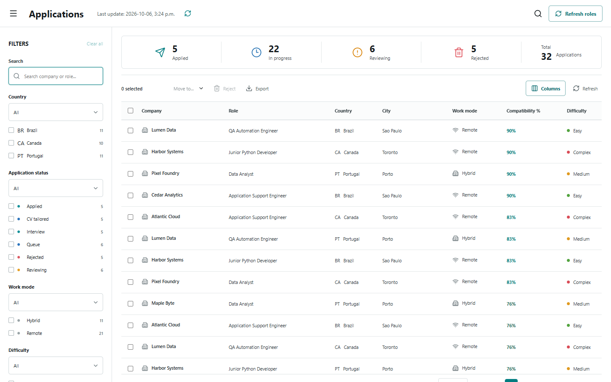
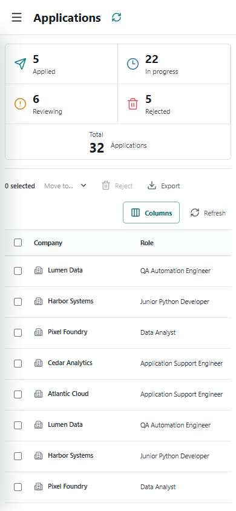

# Job Application Tracker Demo

[English / README principal](README.md) · Português (Brasil)

Um painel em React e SQLite, adequado para apresentação em portfólio, para acompanhar um fluxo fictício de candidaturas a vagas.





## Por que este repositório existe

O fluxo em produção utiliza históricos privados de candidaturas e arquivos de currículo. Este repositório foi reconstruído com um novo histórico Git, empresas fictícias, links de `example.com` e um banco de dados gerado localmente na primeira execução. Não inclui candidaturas, contatos, currículos ou credenciais reais.

## Funcionalidades

- Busca e filtros por país, status, modalidade de trabalho, dificuldade e compatibilidade.
- Seleção de colunas, tabela com suporte a ordenação, paginação e seleção em lote.
- Painel lateral de detalhes para status, dificuldade e anotações.
- Layouts responsivos para desktop e celular.
- API HTTP em Node.js com o módulo SQLite integrado.
- Carga inicial determinística com 32 registros fictícios.
- Testes da API e integração contínua no GitHub Actions.

## Executar localmente

```bash
corepack enable
pnpm install
pnpm build
pnpm start
```

Abra `http://127.0.0.1:4173`. O banco de dados gerado para a demonstração fica em `.data/` e é ignorado pelo Git.

Para desenvolver o frontend:

```bash
pnpm dev
```

## Verificar

```bash
pnpm check
```

## Limites de segurança

Esta é uma demonstração independente, sem exportação do banco de dados privado. O gerador da carga inicial utiliza somente organizações e cargos fictícios. Arquivos de banco de dados, arquivos de ambiente e logs são ignorados.

## Licença

MIT
